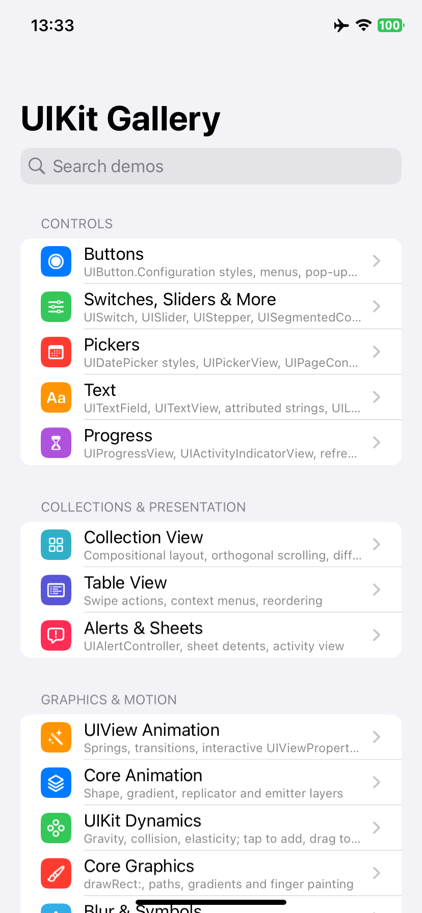
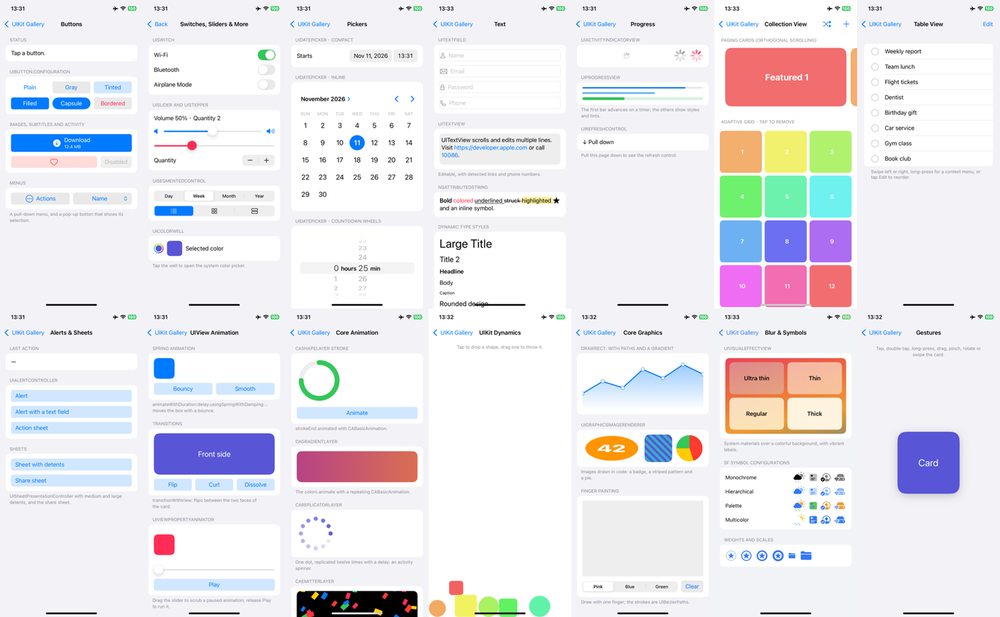

<div align="center">

# UIKit Gallery (Objective-C)

**English** · [简体中文](README_zh.md)

14 UIKit demos written in Objective-C: buttons and menus, value controls, pickers, text, progress, compositional collection views, table view features, alerts and sheets, UIView animation, Core Animation layers, UIKit Dynamics, Core Graphics, blur and SF Symbols, and gestures.<br/>
No storyboards for the screens and no third-party code: every view is built in code, so each demo reads top to bottom.<br/>
Builds and runs on iPhone from Windows, Linux or macOS with [KXBuild](https://github.com/kxbuild/kxbuild).



</div>

## What's inside

| Section | Demo | Shows |
|---|---|---|
| **Controls** | Buttons | `UIButtonConfiguration` styles, subtitles, activity indicator, selection, pull-down menus, pop-up buttons |
| | Switches, Sliders & More | `UISwitch`, `UISlider`, `UIStepper`, `UISegmentedControl` with text and images, `UIColorWell` |
| | Pickers | `UIDatePicker` compact / inline / countdown, `UIPickerView` with three components, `UIPageControl` |
| | Text | `UITextField` keyboards and icons, `UITextView` with data detectors, `NSAttributedString`, Dynamic Type |
| | Progress | `UIActivityIndicatorView`, `UIProgressView` styles, `UIRefreshControl` |
| **Collections & Presentation** | Collection View | `UICollectionViewCompositionalLayout` with orthogonal paging and an adaptive grid, diffable data source, add / shuffle / delete |
| | Table View | Leading and trailing swipe actions, context menus, reordering |
| | Alerts & Sheets | `UIAlertController` alert, text field and action sheet, `UISheetPresentationController` detents, `UIActivityViewController` |
| **Graphics & Motion** | UIView Animation | Spring animations, view transitions, scrubbing a `UIViewPropertyAnimator` |
| | Core Animation | `CAShapeLayer` stroke, animated `CAGradientLayer`, `CAReplicatorLayer` spinner, `CAEmitterLayer` confetti |
| | UIKit Dynamics | Gravity, collisions and elasticity; tap to drop, drag to throw with an attachment behavior |
| | Core Graphics | `drawRect:` with paths and a clipped gradient, `UIGraphicsImageRenderer` images, finger painting |
| | Blur & Symbols | `UIVisualEffectView` materials with vibrancy, SF Symbol rendering modes, weights and scales |
| | Gestures | Tap, double tap, long press with haptics, pan, simultaneous pinch and rotate, two-finger swipe |

The home screen has search and the app follows the system light / dark mode.



## Run it on an iPhone

You need KXBuild installed ([install guide](https://github.com/kxbuild/kxbuild#-install)) and [signing](https://github.com/kxbuild/kxbuild#-signing) set up.

```shell
git clone https://github.com/kxbuild/objc-gallery.git
cd objc-gallery

# Build, install on the USB-connected iPhone and launch it
kxbuild run ObjCGallery.xcodeproj
```

The bundle identifier is `com.kxbuild.objcgallery`. If your provisioning profile does not cover it, switch to one of yours:

```shell
kxbuild project add-setting --project ObjCGallery.xcodeproj --target ObjCGallery --key PRODUCT_BUNDLE_IDENTIFIER --value com.yourcompany.objcgallery
```

To open one demo right away, pass its id as a launch argument, for example `--args "-demo layers"`. The ids are in [GalleryViewController.m](ObjCGallery/GalleryViewController.m).

### In VS Code

Install the KXBuild extension, open this folder, pick the iPhone in the KXBuild view and press F5 to build, install and debug with breakpoints. Code completion for Objective-C works before the first build.

## Project layout

```
ObjCGallery/
  SceneDelegate.m             creates the window and navigation controller
  GalleryViewController.m     the demo list, search and -demo launch argument
  DemoKit.h / .m              DemoViewController (scrolling cards) and small helpers
  ControlsDemos.m             buttons, value controls, pickers, text, progress
  CollectionsDemos.m          collection view, table view, alerts and sheets
  MotionDemos.m               animation, Core Animation, dynamics, drawing, effects, gestures
```

The `ObjCGallery` folder is a synchronized group, so new source files in it are part of the app without editing the project file. To add a demo, write a `UIViewController` subclass and add a `GalleryDemo` entry with its class name in `GalleryViewController.m`.

## License

Apache 2.0. See [LICENSE](LICENSE). UIKit and SF Symbols are trademarks of Apple Inc.
