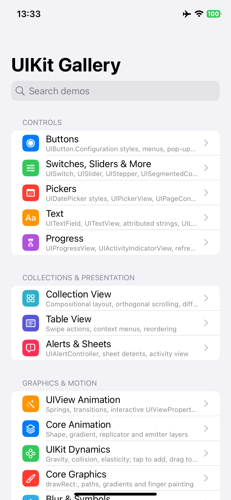
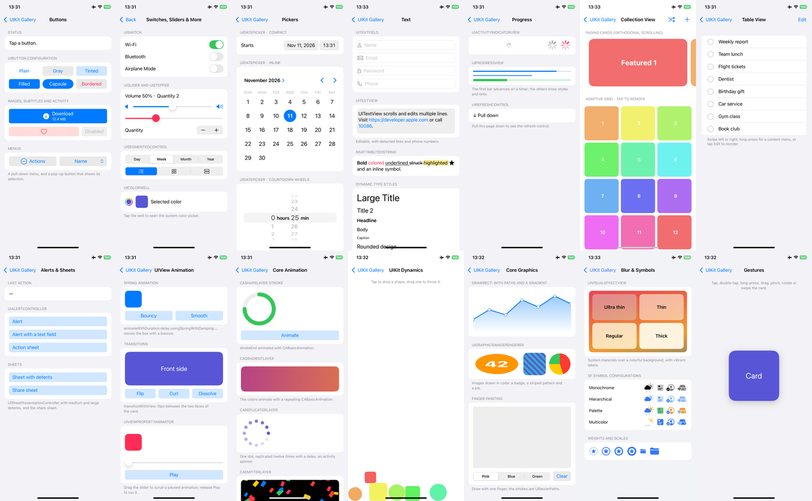

<div align="center">

# UIKit Gallery（Objective-C）

[English](README.md) · **简体中文**

用 Objective-C 编写的 14 个 UIKit 示例：按钮与菜单、数值控件、选择器、文本、进度、组合布局集合视图、表格视图功能、提醒与弹层、UIView 动画、Core Animation 图层、UIKit Dynamics、Core Graphics、毛玻璃与 SF Symbols、手势。<br/>
页面不使用 storyboard，也不依赖第三方代码，所有视图都在代码里创建，每个示例从上到下读一遍就能看懂。<br/>
在 Windows、Linux、macOS 上用 [KXBuild](https://github.com/kxbuild/kxbuild) 即可编译并安装到 iPhone 上运行。



</div>

## 包含内容

| 分类 | 示例 | 展示内容 |
|---|---|---|
| **控件** | Buttons | `UIButtonConfiguration` 各种样式、副标题、加载指示、选中态、下拉菜单、弹出式按钮 |
| | Switches, Sliders & More | `UISwitch`、`UISlider`、`UIStepper`、文字与图标的 `UISegmentedControl`、`UIColorWell` |
| | Pickers | `UIDatePicker` 紧凑 / 内联 / 倒计时，三列 `UIPickerView`，`UIPageControl` |
| | Text | `UITextField` 键盘类型与图标、带数据识别的 `UITextView`、`NSAttributedString`、动态字体 |
| | Progress | `UIActivityIndicatorView`、`UIProgressView` 样式、`UIRefreshControl` |
| **集合与弹层** | Collection View | `UICollectionViewCompositionalLayout` 横向分页与自适应网格，可差异化数据源，增加 / 打乱 / 删除 |
| | Table View | 左右滑动操作、上下文菜单、拖动排序 |
| | Alerts & Sheets | `UIAlertController` 提醒、输入框与操作表，`UISheetPresentationController` 高度档位，`UIActivityViewController` |
| **图形与动效** | UIView Animation | 弹簧动画、视图转场、拖动控制 `UIViewPropertyAnimator` 进度 |
| | Core Animation | `CAShapeLayer` 描边、动画 `CAGradientLayer`、`CAReplicatorLayer` 加载圈、`CAEmitterLayer` 彩纸 |
| | UIKit Dynamics | 重力、碰撞与弹性；点击投放，借助附着行为拖动抛出 |
| | Core Graphics | `drawRect:` 路径与裁剪渐变、`UIGraphicsImageRenderer` 绘制图片、手指涂鸦 |
| | Blur & Symbols | 带活力效果的 `UIVisualEffectView` 材质、SF Symbol 渲染模式、粗细与尺寸 |
| | Gestures | 单击、双击、带触感的长按、拖动、同时缩放与旋转、双指轻扫 |

首页支持搜索，应用跟随系统的浅色 / 深色模式。



## 在 iPhone 上运行

准备：已安装 KXBuild（[安装说明](https://github.com/kxbuild/kxbuild/blob/main/README_zh.md)），并配置好[签名](https://github.com/kxbuild/kxbuild/blob/main/README_zh.md)。

```shell
git clone https://github.com/kxbuild/objc-gallery.git
cd objc-gallery

# 编译，安装到 USB 连接的 iPhone 并启动
kxbuild run ObjCGallery.xcodeproj
```

Bundle ID 是 `com.kxbuild.objcgallery`。如果你的描述文件不包含它，换成你自己的：

```shell
kxbuild project add-setting --project ObjCGallery.xcodeproj --target ObjCGallery --key PRODUCT_BUNDLE_IDENTIFIER --value com.yourcompany.objcgallery
```

想启动后直接打开某个示例，把它的 id 作为启动参数传入，例如 `--args "-demo layers"`。全部 id 见 [GalleryViewController.m](ObjCGallery/GalleryViewController.m)。

### 在 VS Code 里开发

安装 KXBuild 扩展，打开本目录，在 KXBuild 视图里选中 iPhone 后按 F5，即可编译、安装并带断点调试。首次编译前就有 Objective-C 代码补全。

## 目录结构

```
ObjCGallery/
  SceneDelegate.m             创建窗口和导航控制器
  GalleryViewController.m     示例列表、搜索和 -demo 启动参数
  DemoKit.h / .m              DemoViewController（滚动卡片页面）和小工具函数
  ControlsDemos.m             按钮、数值控件、选择器、文本、进度
  CollectionsDemos.m          集合视图、表格视图、提醒与弹层
  MotionDemos.m               动画、Core Animation、物理、绘图、视觉效果、手势
```

`ObjCGallery` 文件夹是同步文件夹组，放进去的源文件会自动加入应用，无需修改工程文件。新增示例：写一个 `UIViewController` 子类，再到 `GalleryViewController.m` 里加一条带类名的 `GalleryDemo`。

## 相关仓库

- [**KXBuild**](https://github.com/kxbuild/kxbuild)：在 Windows、Linux、macOS 上编译、运行、发布 iOS App 的命令行工具和 VS Code 插件
- [SwiftUI Gallery](https://github.com/kxbuild/swift-gallery)：15 个 SwiftUI 示例：控件、列表、动画、手势、Swift Charts、MapKit、SwiftData
- [Flutter Gallery](https://github.com/kxbuild/flutter-gallery)：Material 与 Cupertino 组件，外加四个完整示例应用
- [React Native Gallery](https://github.com/kxbuild/react-native-gallery)：16 个 React Native 内置组件与 API 示例
- [Expo Gallery](https://github.com/kxbuild/expo-gallery)：22 个 Expo SDK 模块：相机、传感器、定位、SQLite 等
- [Godot Gallery](https://github.com/kxbuild/godot-gallery)：10 个 Godot 4 示例，导出为 iOS 工程
- [Unity Gallery](https://github.com/kxbuild/unity-gallery)：10 个 Unity 6 示例，导出为 iOS 工程
- [KXBuild 应用模板](https://github.com/kxbuild/kxbuild-app-templates)：`kxbuild project create` 和 `add-target` 使用的项目与 target 模板，欢迎贡献

## 许可证

Apache 2.0，见 [LICENSE](LICENSE)。UIKit 和 SF Symbols 是 Apple Inc. 的商标。
